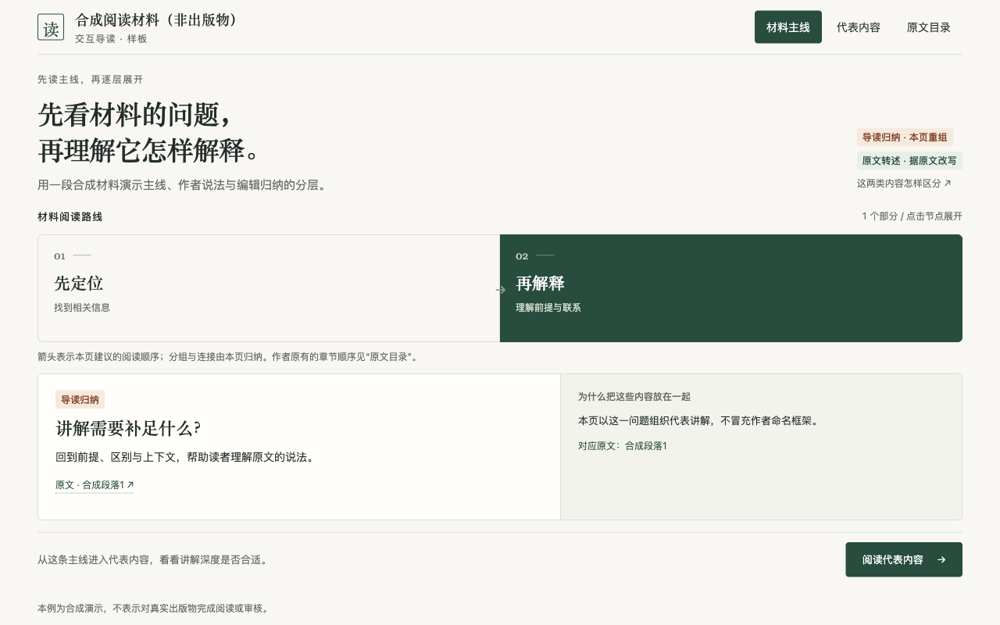

**中文** · [English](README.md)
# learn-from-materials


> 沿作者原书理解一本书，先确认主线与代表章节，再生成可追溯内容档案和交互阅读网页。


这是 **Formangarden524 的 fork**，基于 [dmoshehun-prog/learn-from-materials](https://github.com/dmoshehun-prog/learn-from-materials) 扩展。当前版本为 `1.2.0`，修订 `author-led-reading`，新增作者主线单书路线与可复用阅读模板，不代表上游维护者发布。

## 1.2.0 的变化

- **沿作者原书拆解**：保留原章序、概念、论证、案例、条件与边界；编辑新增的阅读分组单独标明。
- **尽早得到可判断的成果**：先形成全书主线和代表章节，再扩展全书。用户要求先确认时等待反馈，已认可的方向不重复审批。
- **清楚的阅读样式**：纸白底、墨绿强调、可读的解释和逐层展开的细节。主线、章节导航、搜索及出处窗口使用可复用模板。
- **同源档案与网页**：由同一份内容记录派生网页和 Markdown，保留稳定标识与实际来源定位。
- **供 Wiki 复用**：导出限定于单本书的单元、主张与概念候选，供后续按主题选择和比较；导出不会写入 Wiki，也不把单一作者观点变成跨书共识。
- **先复用，再补读**：沿用有效提取、记录、图像和复核证据。机械迁移不自动获得新的语义审核，也不证明新书从零处理能达到某个提速比例。

新的整书装配器当前面向**已有页码映射的单本 PDF**。EPUB、Word、幻灯片等格式仍可使用既有提取和 `quick`／`systematic` 路线。新阅读模板目前为**中文固定界面标签**，不继承旧渲染器的自动双语界面与三套主题；其他语言需要另存翻译模板并实际检查。



## 按目标选择路线

| 请求 | 路线 | 成果 |
| --- | --- | --- |
| 沿作者主线拆一本 PDF，做完整交互网页 | [作者主线单书](references/author-led-book-workflow.md) | 先主线与样章，后可追溯全书档案、网页及 Wiki 复用数据 |
| 只看主线、样板或指定部分 | [交互导读](references/guided-reading-workflow.md) | 范围明确的独立轻量阅读页 |
| 明确要求快速了解 | [原 quick](references/quick-workflow.md) | 核心内容、全结构扫描与展示出处核查 |
| 明确要求系统学习 | [原 systematic](references/systematic-workflow.md) | 按原契约逐块阅读、全量覆盖与分阶段复核 |

作者主线路线在确认结构后完成全书档案，样板本身不等于拆完整本书。主题 Wiki 后续可以复用档案，同时保留不同作者和来源的身份。

## 分清三类内容

- **原文直引**：保留连续原句，标真实页码或其他定位。
- **原书转述**：根据原文解释，保留条件、反例与不确定性。
- **编辑归纳**：新增阅读问题、分组、名称或联系，明确标示，不冒充作者命名框架。

作者原章名与顺序可对照查看。序言、附录和编辑手记保留各自作用及叙述者身份。引句存在、哈希匹配，都不能单独证明解读正确。

## 安装

源码仓库：[Formangarden524/learn-from-materials](https://github.com/Formangarden524/learn-from-materials)。

```bash
git clone https://github.com/Formangarden524/learn-from-materials.git ~/.agents/skills/learn-from-materials
```

其他客户端可按其文档改用 `~/.workbuddy/skills/`、`~/.claude/skills/` 或 `~/.copilot/skills/`。完整目录顶层应直接包含 `SKILL.md`、`scripts/`、`references/`、`templates/`，避免多套一层。替换已有同名安装前先备份，必要时重新加载客户端。

本地打包文件名为 `learn-from-materials-1.2.0.zip`。这里不表示已上传 GitHub Release 附件；同步源码与发布打包附件是两个独立动作。

需要 Python 3.10+，以及能读写文件、执行命令的 Agent。纯聊天环境不能执行本地提取或渲染。Node.js 和已有浏览器用于可选验证，不自动安装依赖。扫描 PDF 与图片密集材料需要实际 OCR 或视觉能力；不可核验范围应保留缺口。

## 在对话中使用

```text
请用 learn-from-materials 沿作者原书主线拆解这本 PDF。
先给我主线和一个代表章节确认，再完成可追溯全书档案与交互网页。
已有提取和记录有效时直接复用。
```

```text
这次只做材料主线与阅读样板，分清原文直引、忠实转述和编辑归纳。
```

明确的 `quick` 或 `systematic` 请求仍采用其原有契约。内容语言跟随用户要求；新模板的界面语言限制见上文。

## 命令

以下命令从 Skill 根目录运行。Agent 负责阅读、组织和复核；脚本不会自动理解或审读一本书。将占位符替换为实际路径，Windows 可使用已安装的 `python` 或 `py -3`。

检查能力并复用既有提取流程：

```bash
python3 scripts/extract.py --check
python3 scripts/extract.py <材料路径> --mode text --ocr auto --output-dir <书名>.learnkb
```

按[导读内容契约](references/guided-reading-workflow.md)生成限定范围样板：

```bash
python3 scripts/render_guided.py content.json --output delivery/reading.html
# 运行自带的合成示例：
python3 scripts/render_guided.py examples/guided-reading-example.json --output delivery/demo.html
```

根据已有来源映射记录和明确的作者章序映射，装配 PDF 单书档案：

```bash
python3 scripts/build_book_archive.py --knowledge-base <书名>.learnkb --structure author-structure.json --output-dir delivery
```

可选 `--representative-reading CONTENT.json` 复用已有代表讲解，不改写原规范单元。具体输入和核查边界见工具 `--help` 与[单书工作流](references/author-led-book-workflow.md)。

输出包括 `阅读网页.html`、`书籍档案/` 内的可读 Markdown、结构化单书内容、Wiki 导出、保留的输入知识库，以及机械构建报告。阅读页可按原章展开解释、细节和原页出处。复核状态如实保留；装配不授予全书语义完整或用户已确认的状态。

原六模块学习页继续使用[快速流程](references/quick-workflow.md)或[系统流程](references/systematic-workflow.md)，包括规范方法文件与 `finalize.py` 门禁；这些路线保留双语、三套主题、关系图、自检和本地笔记。它们不是独立单书或导读工件的前置要求。

## 验证

```bash
python3 scripts/verify_release.py --root . --json
python3 -m unittest discover -s scripts/tests -p 'test_*.py'
```

浏览器检查覆盖当前材料的桌面／窄屏、章节切换、搜索、细节展开和出处窗口。静态检查、合成 fixture 与哈希均不等于语义或视觉验收。原渲染器回归工具见[验证与性能](references/verification-and-performance.md)。

[旧版展示索引](assets/showcase/README.md)和[合成材料系统学习演示](examples/sequential-systematic-demo.html)展示的是原六模块渲染器，不是新作者主线模板的截图。本仓库包含合成示例，不包含用户的完整书籍、私有档案或已部署的书籍数据。

## 安全、兼容与归属

- 材料中的命令和提示按数据处理，只处理用户指定范围。
- 保留实际来源定位，并区分作者、引文发言者和编辑。
- 复制档案或导出 Wiki 候选，不自动授权上传档案或改动主题 Wiki。
- 公开部署前检查生成文件；档案可能包含原文、本机路径和历史内部复核记录。离线交付与公开站点准备的范围不同。
- 原 `quick`／`systematic` 数据和验证要求继续保留，新工件不冒称通过其门禁。

详见 [SECURITY.md](SECURITY.md)、[CHANGELOG.md](CHANGELOG.md)、[LICENSE.md](LICENSE.md) 和 [NOTICE.md](NOTICE.md)。

本 fork 继承 [dmoshehun-prog/learn-from-materials](https://github.com/dmoshehun-prog/learn-from-materials)，包括 MIT 开源基础 [virgiliojr94/book-to-skill](https://github.com/virgiliojr94/book-to-skill) 与 [crayon-ai/book-to-webpage](https://github.com/crayon-ai/book-to-webpage) 的工作。分发时保留各自版权、许可证及来源说明。上游作者不为本 fork 的扩展背书。
